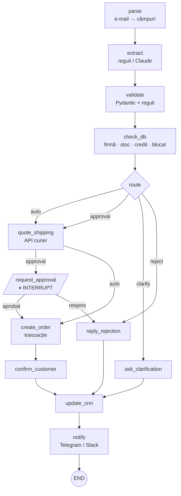

# ⚙️ ai-ops-workflow

Un workflow AI pentru o problemă reală de operațiuni: **comenzile B2B care vin pe e-mail**.

Un client scrie *„vă rugăm să ne livrați 6 laptopuri ThinkPad, IDNO …, livrare la Chișinău”*. Sistemul:

1. **extrage** datele în JSON validat (reguli sau Claude);
2. **validează** câmpurile și **verifică în baza de date** firma, stocul, creditul și dacă e blocată;
3. **decide ruta**: automat, aprobare umană, cerere de clarificare sau respingere;
4. cere o **cotație de la curier** (API extern);
5. dacă e nevoie, **se oprește și așteaptă un om** (interrupt), chiar și zile întregi, chiar și după un restart;
6. **creează comanda** într-o tranzacție, răspunde clientului, **actualizează CRM-ul** și **anunță echipa** (Telegram/Slack);
7. scrie fiecare pas într-un **audit log cu lanț de hash-uri**. Dacă procesul cade la oricare pas, **continuă de unde a rămas, fără dubluri**.

> Pasul 4 din planul meu de studiu: Proiectul 2 (AI Operations Workflow). Pune accent pe state, human-in-the-loop, idempotency și recuperare după crash.


## Graful



## Regulile de rutare (în cod, nu în prompt)

| Rută | Când | Exemplu din `samples/` |
|---|---|---|
| **reject** | firma are contul blocat | `04` — Constructii Rapide |
| **clarify** | lipsește firma / orașul / produsele, SKU necunoscut, dată în trecut | `05` (TAB-SAM11 nu există), `07` (Gmail, fără IDNO), `08` (limbaj natural, fără SKU) |
| **approval** | total > 20 000 lei · depășește creditul disponibil · stoc insuficient · client nou | `02` (101 388 lei), `03` (credit 1 500 lei), `06` (UPS fără stoc) |
| **auto** | restul | `01` — Agro-Nord, 13 153 lei |

LLM-ul doar **citește** e-mailul. Faptul că o comandă de 100 000 de lei trece sau nu fără om îl decide `nodes.route`, care poate fi testat și auditat.

## Ce se întâmplă dacă procesul cade la pasul 6?

Fiecare nod e urmat de un **checkpoint** în SQLite: starea completă, nodul următor și statusul.
`resume(run_id)` reia de la nodul care a căzut, nu de la început. Rămâne problema nodurilor care au efecte în exterior:

| Unde cade | Ce ar merge prost fără protecție | Protecția | Test |
|---|---|---|---|
| API-ul curierului nu răspunde | — | run-ul devine `failed`, `resume-failed` îl reia | `test_courier_down_then_resume` |
| CRM-ul a salvat, dar noi am primit timeout | activitate dublă în CRM | `Effects.once(key)` + header `Idempotency-Key` trimis CRM-ului | `test_crm_wrote_but_connection_dropped` |
| eroare la mijlocul creării comenzii | comandă fără produse, stoc scăzut degeaba | o singură tranzacție, cu `ROLLBACK` | `test_crash_inside_create_order_rolls_back` |
| create_order rulează de două ori | două comenzi | `orders.run_id UNIQUE`, nodul verifică întâi | `test_same_email_twice_does_not_duplicate_the_order` |
| restart cât timp se așteaptă aprobarea | aprobarea se pierde | interrupt-ul e salvat în checkpoint; orice proces nou îl poate relua | `test_process_restart_while_waiting_for_approval` |
| același e-mail livrat de două ori (IMAP, webhook) | două run-uri | `run_id = sha256(Message-ID)` | idem |

Cheia de idempotență e `run_id:nod`. E stabilă între reîncercări, deci serviciul extern recunoaște repetarea.

## Demo

```bash
git clone https://github.com/cs1lyuha/ai-ops-workflow.git
cd ai-ops-workflow
python3 -m venv .venv && source .venv/bin/activate
pip install -r requirements.txt

python -m opsflow.cli demo
```

```
run-9a17392bd422  done     rută=auto      comanda #1 (confirmed, 13153 lei)
run-b742ad5100b2  waiting  rută=approval  ⏸ Clinica Vita Med SRL, 101388 lei: valoare 101388 lei > pragul de 20000 lei
run-835848193f8c  waiting  rută=approval  ⏸ Birou Expert Contabil SRL, 8598 lei: depășește creditul disponibil (1500 lei)
run-f12bedecc519  done     rută=reject    clientul are contul blocat (datorii restante)
run-44801386a979  done     rută=clarify   coduri necunoscute: TAB-SAM11
run-e990dc89c380  waiting  rută=approval  ⏸ Clinica Vita Med SRL, 7798 lei: stoc insuficient: UPS-APC1500 (0/2)
run-982b552973a4  done     rută=clarify   lipsește orașul de livrare; nu am identificat firma (IDNO lipsă sau necunoscut)
run-e385e9ebdae1  done     rută=clarify   nu am găsit produse cu cod SKU în e-mail

→ operatorul aprobă tot ce așteaptă:

run-b742ad5100b2  done     rută=approval  comanda #2 (confirmed, 101473 lei)
run-835848193f8c  done     rută=approval  comanda #3 (confirmed, 8708 lei)
run-e990dc89c380  done     rută=approval  comanda #4 (backorder, 7848 lei)

Audit: 78 pași, lanț intact
```

Fluxul real, cu bază persistentă:

```bash
python -m opsflow.cli ingest samples/*.eml
python -m opsflow.cli pending
python -m opsflow.cli approve run-b742ad5100b2 --by ana
python -m opsflow.cli audit run-b742ad5100b2

# extragere cu Claude (înțelege și „trei imprimante HP”, e-mailul 08)
pip install anthropic && export ANTHROPIC_API_KEY=...
python -m opsflow.cli --claude ingest samples/08-natural-language.eml

# notificări pe Telegram
export TELEGRAM_BOT_TOKEN=... TELEGRAM_CHAT_ID=...
```

## Reguli vs. Claude la extragere

| | `RuleExtractor` | `ClaudeExtractor` |
|---|---|---|
| „5 x KIT-LOGI”, „LAP-TP14: 6 buc.” | ✅ | ✅ |
| „trei imprimante HP LaserJet și zece kituri Logitech” | ❌ → clarify | ✅ mapat pe `PRN-HP4103`, `KIT-LOGI` |
| cost | 0 | ~1 cerere / e-mail; catalogul stă în system prompt cu `cache_control` |
| output | Pydantic | JSON Schema strict (`output_config.format`) **+** aceeași validare Pydantic |

Output-ul lui Claude trece prin aceeași validare ca regulile (`test_claude_extractor_output_is_still_validated`): un IDNO inventat de 3 cifre e respins înainte să ajungă în DB.

## Structura

| Fișier | Rol |
|---|---|
| `opsflow/engine.py` | motorul: `Graph`, routere, `Runner` cu checkpoint după fiecare nod, `Interrupt`, `resume` |
| `opsflow/db.py` | schema SQLite, `SqliteCheckpoints`, `Effects.once` (idempotency), `AuditLog` cu lanț SHA-256 |
| `opsflow/extract.py` | parsare e-mail, `PurchaseOrder`, extractor pe reguli și extractor Claude |
| `opsflow/nodes.py` | nodurile și regulile de business |
| `opsflow/services.py` | curier, CRM, Telegram, e-mail (fake + HTTP) |
| `opsflow/workflow.py` | graful și `OpsApp` (`handle_email`, `decide`, `resume_failed`) |
| `opsflow/cli.py` | linia de comandă |

**Teste: 44**, câte cel puțin unul pentru fiecare ramură a grafului și pentru fiecare punct de cădere din tabelul de mai sus. Rulează cu `pytest -q`.

## De ce motor propriu și nu LangGraph?

Ca să înțeleg ce face un framework înainte să-l folosesc. Conceptele sunt aceleași, deci migrarea e directă:

| aici | LangGraph |
|---|---|
| `Graph.add_node / add_edge / add_router` | `StateGraph.add_node / add_edge / add_conditional_edges` |
| `raise Interrupt(payload)` | `interrupt(payload)` |
| `Runner.resume(run_id, update)` | `graph.invoke(Command(resume=...), config={"thread_id": ...})` |
| `SqliteCheckpoints` | `SqliteSaver` / `PostgresSaver` |

## Ce urmează

- [ ] PostgreSQL în loc de SQLite (`SELECT … FOR UPDATE` pe stoc, la comenzi concurente)
- [ ] Ingest real din IMAP / webhook Gmail
- [ ] Interfață web pentru operator (lista de aprobări, cu diff-ul comenzii)
- [ ] Varianta LangGraph a aceluiași graf, cu aceleași teste
